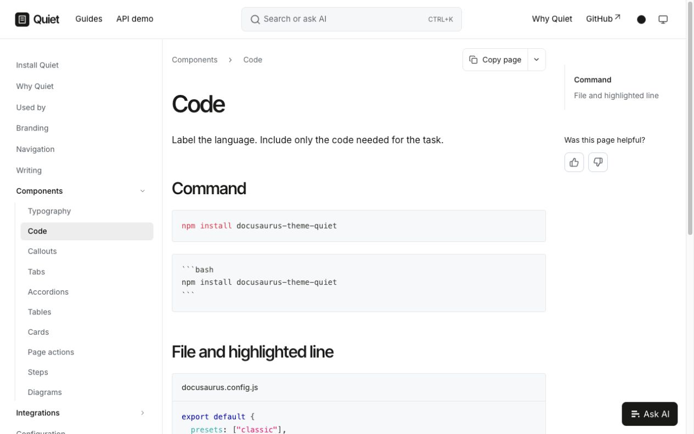

# Quiet

A minimal Docusaurus theme built on Classic.

[Documentation](https://quiet.techdocs.studio) · [Components](https://quiet.techdocs.studio/components) · [API demo](https://quiet.techdocs.studio/api/quiet-demo-api) · [Used by](https://quiet.techdocs.studio/used-by)



## Install

```sh
npm install docusaurus-theme-quiet
```

```js
// docusaurus.config.js
export default {
  presets: ["classic"],
  themes: ["docusaurus-theme-quiet"],
};
```

The first npm release is pending. Until then, run `npm run pack:theme` and install the tarball from `.artifacts/`.

## Make it yours

Use Docusaurus settings for your logo, navigation and content. Configure colors through the theme options, and fonts through CSS variables.

- Light and dark modes, readable typography and compact controls.
- Guides, API references, code, callouts, tables and diagrams.
- Optional search, Ask AI and page feedback. Your provider stays yours.
- Configurable page actions, Markdown links and MCP setup commands.

Quiet keeps Classic's navigation, routing, keyboard controls and metadata.

## Develop

```sh
npm ci
npm start
```

[Contributing](CONTRIBUTING.md) · [Release guide](RELEASING.md) · [Validation](VALIDATION.md)

MIT · By [TechDocs Studio](https://techdocs.studio).
