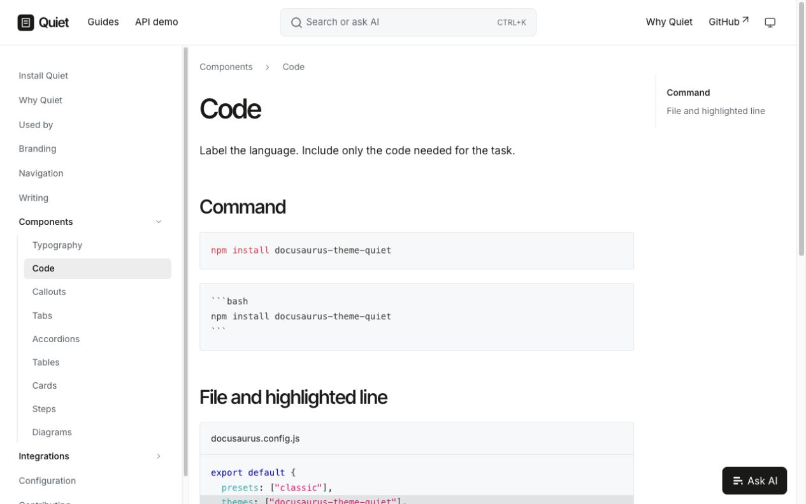

# Quiet

A minimal Docusaurus theme built on Classic.

[Documentation](https://quiet.techdocs.studio) · [Components](https://quiet.techdocs.studio/components) · [API demo](https://quiet.techdocs.studio/api/quiet-demo-api)



## Install

Requires Docusaurus 3.10.x with the Classic preset.

```sh
npm install docusaurus-theme-quiet
```

```js
export default {
  presets: ["classic"],
  themes: ["docusaurus-theme-quiet"],
};
```

## Configure

```js
themes: [
  [
    "docusaurus-theme-quiet",
    {
      accentColor: "#23734a",
      accentColorDark: "#8bc9a5",
    },
  ],
];
```

Use Docusaurus settings for logos and navigation. CSS variables control fonts, width and surfaces. Quiet supports light and dark modes, adds MDX cards and steps, and keeps Classic's routing, keyboard behavior and metadata.

Search, AI assistance and feedback are optional integrations. The theme loads no external fonts or services.

The footer shows **Powered by Quiet** by default. Set `showCredit: false` to remove it.

MIT · By [TechDocs Studio](https://techdocs.studio).
