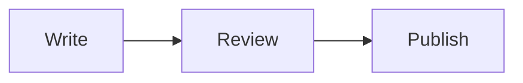

import Tabs from "@theme/Tabs";
import TabItem from "@theme/TabItem";

## Text

Documentation starts with a clear title and a useful paragraph. Use **bold** for actions, `code` for identifiers and [links to a specific task](/branding).

### A subsection

Keep headings in sentence case. Reading text is 17px. Labels and code stay at least 14px.

- Show the next action.
- Keep prerequisites visible.
- Explain how to check the result.

> Keep the detail that changes what the reader needs to do.

[Typography and Markdown examples](/components/typography)

## Code

```js title="docusaurus.config.js" {3}
export default {
  presets: ["classic"],
  themes: ["docusaurus-theme-quiet"],
};
```

[Code blocks, commands and highlighted lines](/components/code)

## Callouts

:::note Note
Restart the development server after changing the theme configuration.
:::

:::warning Warning
Changing document slugs can break existing links. Add redirects when a URL must change.
:::

[All callout types and their source](/components/callouts)

## Tabs

<Tabs groupId="package-manager">
<TabItem value="npm" label="npm" default>

```bash
npm install docusaurus-theme-quiet
```

</TabItem>
<TabItem value="pnpm" label="pnpm">

```bash
pnpm add docusaurus-theme-quiet
```

</TabItem>
</Tabs>

[Tab syntax and keyboard behavior](/components/tabs)

## Accordions

<details>
<summary>Can I keep my current content?</summary>

Yes. Quiet extends Classic. Keep your document files, IDs, routes and navigation. Review old CSS and component overrides when adopting a new theme.

</details>

[Accordion source and usage](/components/accordions)

## Tables

| Setting    | Light mode   | Dark mode    |
| ---------- | ------------ | ------------ |
| Background | White        | Near black   |
| Text       | Near black   | Near white   |
| Accent     | Configurable | Configurable |

[Table syntax](/components/tables)

## Cards

<CardGrid>
  <Card to="/branding" title="Branding">
    Set your colors, logo and typography.
  </Card>
  <Card to="/navigation" title="Navigation">
    Organize guides and reference pages.
  </Card>
</CardGrid>

[Card component reference](/components/cards)

## Steps

<Steps>
  <Step title="Install the package">

    Add Quiet to an existing Docusaurus site.

  </Step>
  <Step title="Enable the theme">

    Add the package to the `themes` array and restart your server.

  </Step>
  <Step title="Check the result">

    Review a page in light mode, dark mode and on a phone.

  </Step>
</Steps>

[Step component reference](/components/steps)

## Diagrams



The document moves from writing to review and publication.

[Mermaid setup and source](/components/diagrams)
